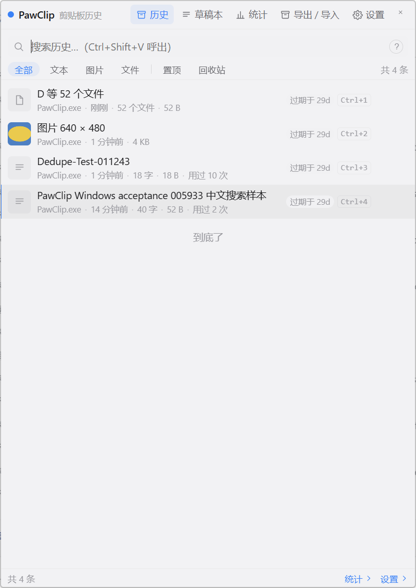
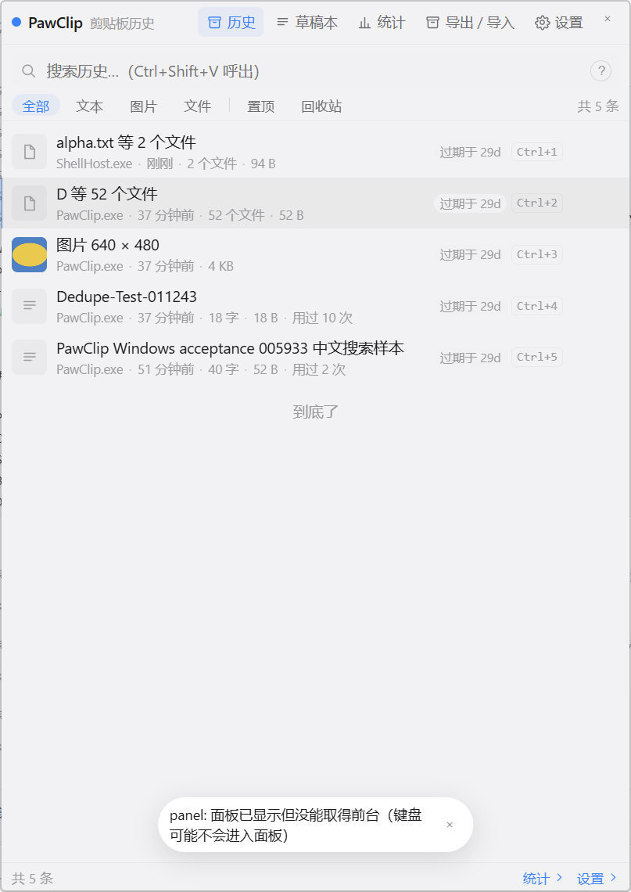
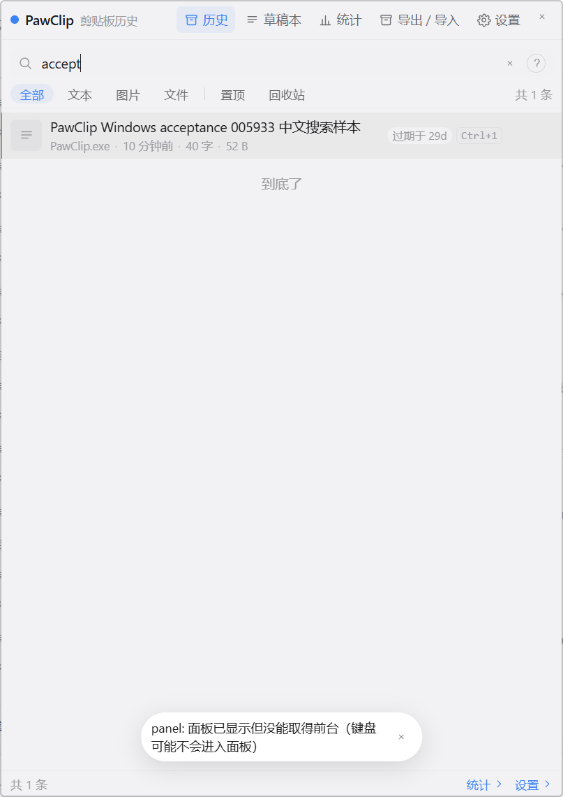

# PawClip Windows 真机验收报告（v0.1.4）

> 实测环境：Windows 11 24H2（build 26100）· 2560×1600 @ **150% 缩放** · 单显示器 · WebView2 Runtime 156.0.4314.50
> 被测产物：`PawClip-windows-amd64.exe`（portable，v0.1.4，SHA256 `7ee06de1…24da`）
> 实测日期：2026-10-31
> 版本说明：文中 `0.1.11`–`0.1.17` 是本地验收构建标签；**正式发布版本为 0.1.5**。
> 与 [ACCEPTANCE.md](ACCEPTANCE.md) 的分工：那份是 **macOS** 的真机口径；这份是 **Windows 的首轮真机**口径，不替代 §12 的完整验收表。

---

## 0. 结论

**核心数据链路可用，但不能据此认为 Windows 可发布。** 本轮证明：程序能启动、热键能呼出、文本 / 图片能捕获、全文检索能命中、`Ctrl+1` 能回贴、去重与崩溃恢复都成立。

发现 **1 个发布阻断级 bug + 4 个高 / 中问题**，均已在本地验收构建上修复并复测；另有 12 项试用反馈在本轮验收构建中修复（见 §3.9），统一随正式版 **0.1.5** 发布：

| # | 问题 | 严重度 | 状态 |
|---|---|---|---|
| 1 | CF_HDROP 结构体少了 `fNC`，**文件类型捕获全坏**（一个文件被拆成一堆单字符"文件"） | 🔴 阻断 | **已修并复测**（代码 + 单测 + 真剪贴板 + 0.1.11 构建） |
| 2 | `ui.closeOnBlur` 在 Windows 上**没有实现**，点面板以外不会收起 | 🟠 高 | **已修**（前台钩子；0.1.11 复测） |
| 3 | `WS_EX_NOACTIVATE` 导致**失焦后点不回面板**，草稿也打不进字 | 🟠 高 | **已修**（去掉该样式；0.1.11 复测） |
| 4 | 每次呼出都弹一条**假的**"未能取得前台"警告（且文案未走 i18n） | 🟡 中 | **已修**（等待生效 + 本地化；0.1.11 复测） |
| 5 | 按住标题栏**拖不动**窗口（v0.1.4 未覆盖） | 🟠 高 | **已修**（自跟踪拖动循环；0.1.11 复测） |

另有 2 条**待定 / 环境**项（面板宽度 560→538、Enter 自动化不触发、从 `.workbuddy\tmp` 启动 WebView2 失败），见 §3.5–§3.7。

---

## 1. 环境与方法

| 项 | 值 |
|---|---|
| 系统 | Windows 11 24H2，`Microsoft Windows NT 10.0.26100.0` |
| 显示 | 物理 2560×1600，逻辑 1707×1067（150%），单屏 |
| WebView2 | **156.0.4314.50**（另装有 155.0.4283.62） |
| 安全软件 | 火绒（`HRWSCCtrl` / `HipsTray` 在跑）；Smart App Control 关闭（`VerifiedAndReputablePolicyState=0`） |
| 产物 | Release 的 portable exe；未签名（既定取舍），已手工解除 MOTW |
| 数据目录 | 隔离在仓库内：`D:\go\PawClip\.workbuddy\tmp\win-accept\`（`.gitignore` 覆盖） |
| 可执行文件 | 复制到 `%LOCALAPPDATA%\Programs\PawClipAccept\PawClip.exe` 后启动（原因见 §1.3） |

### 1.1 隔离运行

- 用 `-config` 指向隔离的 `config.toml`，数据库与 `blobs/` 全落在 `.workbuddy/tmp/win-accept/`，**不碰** `%AppData%\PawClip` 的真实数据。
- 启动方式：任务计划程序 → `wscript.exe` → 隐藏的 `cmd` → exe（日志重定向到 `run-alt.cmd.*.log`）。这样做是为了绕开 DSH 宿主的作业对象，并避免控制台窗口盖在桌面上。
- 每次测试结束用 `schtasks /End` + `Stop-Process` 停止；计划任务已删除。

### 1.2 取证手段

- **截图**：先声明 `PER_MONITOR_AWARE_V2` 再抓，得到 1:1 物理像素。
- **窗口**：`EnumWindows` / `GetWindowRect` / `GetForegroundWindow`，确认 `wailsWindow` 的可见性、位置、尺寸与前台归属。
- **热键**：`SendInput` 注入 `Ctrl+Shift+V`；面板可见性用 `IsWindowVisible` 轮询判定（5 ms）。
- **数据库**：Python 3.10 `sqlite3` 以 `mode=ro` 只读打开（WAL 下不锁写）。
- **剪贴板**：文本用 `Set-Clipboard`；图片走 STA 子进程 `Clipboard.SetImage`；文件用原生 `SetClipboardData(CF_HDROP)`（按 Win32 规范构造，见 §5）。

### 1.3 一个环境坑：从 `.workbuddy\tmp` 启动时 WebView2 报 8000FFFF

同一个 exe：

- 放在 `D:\go\PawClip\.workbuddy\tmp\win-accept\` → 每次都在 controller 创建阶段失败：
  `[WebView2 Error] error creating controller with 8000ffff: Catastrophic failure`；`Environment created successfully` 之后立刻退出。
- 复制到 `%LOCALAPPDATA%\Programs\PawClipAccept\` → 正常启动。

排除过的因素：DSH 作业对象（任务计划程序启动同样失败）、WebView2 用户数据目录（`WEBVIEW2_USER_DATA_FOLDER` 指向新目录无效）、运行时版本（强制 155 同样失败）。最可能是火绒的路径策略（隐藏 / 临时目录）或 WebView2 对该目录的处理，**未定论**。

> 对验收脚本的含义：**不要把被测 exe 放在 `.workbuddy/tmp` / `%TEMP%` 这类目录下**，否则会得到"程序起不来"的假结论。这条应写进 `test/README.md`。

---

## 2. 已通过项

| 项 | 预期 | 实测 | 取证 |
|---|---|---|---|
| 冷启动 / 建库 | 首次启动建 schema、`fts5=true` | 日志依次 `database migrated` v0→v1→v2→v3→v4；`fts5=true` | `run-alt.cmd.err.log` |
| 崩溃恢复 | 强杀后重启可开库、无悬空 | 强杀后再启动：`clean_shutdown marker found and integrity check passed` | 同上 |
| 热键呼出 | 面板出现，目标 < 500 ms | **13.9 ms** 可见（注入到可见的一次采样） | 窗口可见性轮询 |
| 面板几何 | 顶部 12% 留白、水平居中、560×760 | 逻辑 `573,128 560×760`（屏 1707×1067：x 居中 573，y=128=12%） | `GetWindowRect` |
| 150% DPI 渲染 | UI 不被裁切 / 不缩在角落 | 列表、标题栏、中文、圆角、滚动均正常 | 截图 |
| 文本捕获 | 文本落库，preview 正确 | 1 条，`preview` 与原文一致，`byte_size=52` | DB |
| 去重置顶 | 同一内容 10 次 → 1 行、`use_count=10` | 目标条目 **1 行、`use_count=10`**（库里共 2 条：另有 1 条早先的文本） | DB |
| 图片捕获 | `kind=image`，原图 + 缩略图 | `图片 640 × 480`，`image_path` 与 `thumb_path` 均存在，blob 文件已落盘 | DB + `blobs/` |
| 全文检索 | "acceptance" 命中 | 输入 `accept` 后列表剩 1 条 | 截图 |
| `Ctrl+1` 回贴 | 写剪贴板、收面板、`use_count+1` | 面板隐藏；`use_count` 1→2；库中仍 1 行 | DB + `GetForegroundWindow` |
| 每日备份 | 启动时按 20h 规则写 `.clipbak` | `已写入每日备份 … existing=1 keep=7` | 日志 |
| 空闲收起 | 闲置后自动隐藏 | 约 5 分钟后面板隐藏（`ui.windowIdleDestroySec=300`） | 窗口可见性 |

### 0.1.11 修复后复测

| 项 | 实测 |
|---|---|
| 文件捕获 | 标准 CF_HDROP（两条路径，含中文）→ `报告-final.txt 等 2 个文件`，`file_paths` 两条真实路径 |
| 失焦收起 | 面板前台 → 点 Chrome 标题栏 → 1.2s 内面板隐藏 |
| 草稿输入 | 点草稿本 → 点编辑区 → 输入 `hello win 草稿输入` → `drafts.md` 落库 |
| 窗口拖动 | 按住标题栏拖 (180,144) 物理像素 → 窗口 rect 同步移动；隐藏再呼出保持位置 |
| 假焦点警告 | 呼出时日志无 WARN、界面无 toast |
| 多实例 | **已加单实例守卫**：按数据库路径命名互斥量，同一库第二份实例弹框说明后退出；不同 `-config`（不同库）仍可并存 |

---

## 3. 问题

### 3.1 🔴 阻断：CF_HDROP 布局少了 `fNC`，文件捕获全坏

**现象**

用**标准 Win32 CF_HDROP**（`pFiles=20`、`fWide=1`、两条真实路径，UTF-16LE、双 NUL 结尾）写剪贴板，PawClip 落库为：

```json
{
  "kind": "files",
  "preview": "D 等 52 个文件",
  "file_paths": ["D", ":", "\\", "g", "o", "\\", "P", "a", "w", ...],
  "byte_size": 52
}
```

两条路径变成了 **52 个单字符"文件"**。`files-bug.png` 里第一条就是它：



**根因**

[clipboard/normalize_dropfiles.go](../clipboard/normalize_dropfiles.go) 把 `DROPFILES` 定义成了 **16 字节、三个字段**：

```go
type dropFiles struct {
    PFiles uint32   // offset 0
    Pt     winPoint // offset 4（8 字节）
    FWide  int32    // offset 12  ← 错
}                   // sizeof = 16   ← 错
```

而 Win32 的真实定义有**四个**字段（本机 Windows SDK `ShlObj_core.h:1920`）：

```c
typedef struct _DROPFILES {
   DWORD pFiles;   // offset 0
   POINT pt;       // offset 4（8 字节）
   BOOL  fNC;      // offset 12  ← 被漏掉的那个
   BOOL  fWide;    // offset 16
} DROPFILES;       // sizeof = 20
```

于是 app 从**偏移 12** 读 `fWide`，读到的其实是 `fNC`（通常 0）→ 把 UTF-16 路径按 ANSI 逐字节解析 → 每个字符都成了一个"文件名"。

**为什么单测一直绿**

[clipboard/normalize_dropfiles_test.go](../clipboard/normalize_dropfiles_test.go) 的 `TestDROPFILES_LayoutMatchesWin32` **把错误布局当成了契约**：断言 `sizeof=16`、`fWide` 在偏移 12；同文件的 `handBuildDROPFILES` 也按这套错误布局手工造字节。两条用例互相自洽，永远不会红。

**影响**

- 资源管理器里复制文件 → 历史里出现 N 条假文件（N = 路径字符数），预览、去重指纹、回贴内容全错。
- 回贴时写出的 CF_HDROP 是 16 字节头、`pFiles=16`；别的程序按规范从偏移 16 读 `fWide`，读到的恰好是第一个路径的首字符（非 0），**碰巧**会被当成 wide——这是靠巧合工作的，不能依赖。

**建议修法**

1. `dropFiles` 加回 `FNC int32`；`DROPFILESHeaderSize = 20`；`pFiles = 20`；`fWide` 落在 16。
2. `handBuildDROPFILES` 与 `TestDROPFILES_LayoutMatchesWin32` 改成 20 / 16，并**新增一条"Explorer 实测字节"的金标准用例**（把一次真实 Explorer 复制的 CF_HDROP 字节存成 fixture）。
3. 补往返用例：中文路径、多文件、结尾缺双 NUL、空列表。
4. 在 Windows 上做一次端到端：Explorer 复制两个文件 → 落库 2 条路径 → 回贴 → 再粘贴到 Explorer 能识别。

**参考**：`docs/DESIGN.md` §14 第 17 条（过滤顺序）不受影响，但 §12 的"文本 / 图片 / 文件三类统一进历史"在 Windows 上当前只成立两类。

**修复记录（2026-10-31）**

- `dropFiles` 补回 `FNC int32`；`DROPFILESHeaderSize` 16 → 20；`fWide` 回到偏移 16。
- `buildDROPFILES` 的 `pFiles` 随常量变为 20；写出的头部按偏移复核（fNC@12=0、fWide@16=1）。
- 单测改成 SDK 口径，并新增两条防回归用例：
  - `TestParseDROPFILES_ExplorerGolden`：用**显式偏移**手写 20 字节头（不复用被测结构体），
    确保"实现错、测试跟着错"不会再发生；
  - `TestCF_HDROP_RealClipboard`（`//go:build windows`，需 `PAWCLIP_REAL_CLIPBOARD=1`）：
    把外部字节放进**真剪贴板** → 产品代码读出；再 `Write` → `Read` 往返，并复核头部偏移。
- 验证结果：`go test ./clipboard -run 'DROPFILES|CF_HDROP'` 全绿；真剪贴板用例在
  Windows 11 / 150% DPI 上通过。

  ```powershell
  # 纯字节契约（不需要真剪贴板）
  go test ./clipboard -run 'DROPFILES|CF_HDROP' -count=1

  # 真剪贴板往返（会覆盖系统剪贴板）
  $env:PAWCLIP_REAL_CLIPBOARD='1'
  go test ./clipboard -run '^TestCF_HDROP_RealClipboard$' -count=1 -v
  ```

- **产物级复测（2026-10-31，本地构建 `0.1.5-winaccept`）**：用同一份标准 CF_HDROP
  复制两个文件，落库为 `alpha.txt 等 2 个文件`，`file_paths` 是两条真实路径；旧的
  "D 等 52 个文件"仍留在测试库里作对照。

  

- 剩余：正式版本的出包与签名走 CI；本地构建未签名、未打安装器。

---

### 3.2 🟠 高：`ui.closeOnBlur` 在 Windows 上没有实现

**源码**

[panel/dispatch.go](../panel/dispatch.go) 定义了 `emitPanelBlur()`，但它的唯一调用方是 macOS 的 [panel/export_darwin.go](../panel/export_darwin.go)（`pawGoPanelBlur`）。[panel/windows.go](../panel/windows.go) 里没有任何 `WM_ACTIVATE` / 前景窗口监听，Windows 从不触发 [resources.go](../resources.go) 的 `onPanelBlur`。

**实测**

面板通过热键取得前台 → 鼠标点 Chrome 标题栏 → **1.5 s 后面板仍可见**，`GetForegroundWindow` 已是 Chrome；面板最后是被 300 s 的空闲定时器收起的，不是失焦收起。

**影响**

README 与设置项都承诺"点到面板以外自动收起"；Windows 上这条不成立，面板会一直盖在屏幕上。

**修复记录（0.1.11）**

新增独立的 `runBlurThread`（不挂在热键线程上，清空热键也不影响收起），用
`SetWinEventHook(EVENT_SYSTEM_FOREGROUND, …, WINEVENT_OUTOFCONTEXT|WINEVENT_SKIPOWNPROCESS)`
监听前台变化；新前台不是面板且面板可见时 `emitPanelBlur()`。
0.1.11 实测：面板取得前台后点 Chrome 标题栏，1.2s 内面板隐藏。

**建议修法（存档）**

在 Windows 侧加一个失焦源，三选一：

- `SetWinEventHook(EVENT_SYSTEM_FOREGROUND, …)`，新前台 ≠ 面板时 `emitPanelBlur()`（推荐：不需要子类化 Wails 窗口，也不依赖它是否透传 `WM_ACTIVATE`）；
- 子类化窗口过程，拦 `WM_ACTIVATE(WA_INACTIVE)`；
- 定时轮询 `GetForegroundWindow`（最差，耗电且延迟）。

无论哪种，都要避开三类误判：`Show()` 刚把前台抢过来时的瞬时状态、`hideBeforeReveal` 主动让出前台的路径、以及面板自己弹出的系统对话框（辅助功能授权、文件选择）。

---

### 3.3 🟠 高：`WS_EX_NOACTIVATE` 让失焦后的面板点不回来

**源码**

[panel/windows.go](../panel/windows.go) 的 `applyPanelWindowStyle` 给面板加了 `WS_EX_NOACTIVATE | WS_EX_TOOLWINDOW`。

**实测**

面板被 Chrome 拿走前台后，点击面板内部（`WindowFromPoint` 确认命中的是面板）：`GetForegroundWindow` 仍是 Chrome，键盘输入继续进 Chrome；点击无法把键盘焦点拿回来。此时再按一次热键（只呼出）才能把面板重新拿到前台。

**与 3.2 的关系**

两者叠加时，面板会变成"看得见、点不动、键盘也不进"的浮层——这是本轮最影响可用性的组合。修好 3.2 后，点面板以外会直接收起，3.3 的伤害会小很多；但"面板可见但非前台"的时刻仍可能存在（通知抢焦点、用户切窗口），点击回焦依然值得处理。

**修复记录（0.1.11）**

选了"去掉 `WS_EX_NOACTIVATE`"这条路（与设计里"Windows 明确抢一次前台"的取舍一致）。
0.1.11 实测：草稿编辑器可点击并输入，`drafts.md` 落库 `hello win 草稿输入`；
面板可见时就是前台，失焦随即由 §3.2 收起，因此"点不回来"的中间态不再存在。
`docs/DESIGN.md` §8 的旧表述待同步（见 §6）。

---

### 3.4 🟡 中：每次呼出都弹一条假警告，且文案未本地化

**现象**

每次热键呼出，界面底部都会出现：

```
panel: 面板已显示但没能取得前台（键盘可能不会进入面板）
```

同时日志每次一条：

```
level=WARN msg="面板显示时未能取得键盘焦点" err="panel: 面板已显示但没能取得前台（键盘可能不会进入面板）"
```

但 500 ms 后 `GetForegroundWindow()` 就是面板 hwnd，输入也确实进了面板。



**根因**

[panel/windows.go](../panel/windows.go) 的 `Show()` 在 `SetForegroundWindow` 之后**立刻**读 `GetForegroundWindow` 并比较；Win32 的前台切换不是同步完成的，于是检查在成功路径上也会失败。另外错误串是直接 `pushEvent(EventShow, err.Error())` 推给前端的，没走 i18n——英文界面下也会显示中文原文。

**修复记录（0.1.11）**

`Show()` 在 `SetForegroundWindow` 之后最多等 **150 ms** 让前台切换生效，仍失败才
返回错误；错误文案改走 i18n 键 `panel.noFocus`（中英各一条）。
0.1.11 实测：正常呼出不再出现 WARN / toast。

---

### 3.5 ⚪ 待定：面板宽度 560 → 538 被静默持久化

**现象**

一次会话后，库里出现：

```
ui.panelWidth = 538      （默认 560）
```

重启时日志：

```
面板与托盘就绪 … wantW=538 wantH=760 geomNote="Attach：尺寸 560×760 → 538×760"
```

面板从此以 538 逻辑宽启动，用户并没有主动拖过边缘。

**已知线索**

- 538 = 560 − 22；22 逻辑 = 33 物理（150% 下）。
- 本轮有一次点击恰好落在**视口右边缘**（x = 860 + 807 = 1667），随后窗口宽度变成了 807 物理（= 538 逻辑）——正是"边缘缩放把右边界吸附到鼠标位置"的形状。
- 但随后用 DPI-aware 进程在右边缘内 16–22 逻辑像素处做受控点击，**没有**复现 resize。

**结论**

高度疑似与 §8 第 11 条同源（视口 / 窗口宽度不一致 + Wails 在 WebView 里用 `outerWidth` 算边缘热区），但还缺一次严格复现。建议：

1. 在 150% DPI 下用 `PanelDiag` 同时记录 `liveW`（窗口）与 `viewW`（客户区/视口），确认是否存在 33 px 差；
2. 精确点击视口右边缘复现一次；
3. 用 100% DPI 做对照。

---

### 3.6 ⚪ 待定：Enter 在自动化注入下不触发（`Ctrl+1` 正常）

- 空搜索、1 条记录、面板前台：`Ctrl+1` 能回贴（`use_count` +1、面板收起）；`Enter` 不触发（面板不收起、`use_count` 不变）。
- 同样的注入在 `Ctrl+1` 上有效，说明键盘通路是通的；最可能是注入的 Enter 缺少扫描码（0x1C），WebView 收到的事件不是 `key === 'Enter'`。
- **未做人工按键确认**，因此**不记为产品 bug**。需要真人在面板上按一次回车取证；若人工也失败，再查 `activeId` 与 keydown 处理。

---

### 3.7 ⚪ 环境：从仓库临时目录启动 WebView2 失败

见 §1.3。同一 exe 换到 `%LOCALAPPDATA%\Programs` 即正常，**不是产品缺陷**，但会影响验收脚本的落盘位置，需要在测试文档里写明。

---

### 3.8 🟠 高：窗口拖不动（v0.1.4 未覆盖，本轮发现并修复）

**现象**

按住标题栏空白处拖动，窗口完全不动。

**排查**

- 临时日志证明 mousedown 确实走到了 `DragPanel`（按住期间、mousedown 后约 240ms）；
- 原来的 `ReleaseCapture + WM_NCLBUTTONDOWN(HTCAPTION)`，`SendMessage` / `PostMessage`、
  `lParam=0` / 带光标坐标，四种组合都不触发移动循环；
- 长按 3 秒再移动同样无效，排除了"调用太晚、鼠标已松开"。

**修复（0.1.11）**

`Drag()` 改成自跟踪循环：记录起始光标与窗口矩形，按住期间每 8ms 用
`SetWindowPos` 把窗口挪到"起始位置 + 光标位移"，`GetAsyncKeyState(VK_LBUTTON)`
松开即停。0.1.11 实测：拖动 (180,144) 物理像素，窗口 rect 同步移动；隐藏再呼出
保持用户位置（`placed=true`，不再被"鼠标屏顶部居中"拉回去）。

**代价**：拖动期间占用一个 Wails 绑定 goroutine（独立于 UI 线程），不阻塞界面。

### 3.9 0.1.12–0.1.17：试用反馈的十二项修复

| # | 现象 | 根因 | 修法 | 复测 |
|---|---|---|---|---|
| 1 | 设置里清空/换掉快捷键，原来的组合仍然呼出 | 热键线程卡在 `GetMessage`；`close(stop)` 叫不醒它，`UnregisterHotKey` 从未执行 | `stopHotkeyThread` 向线程 `PostThreadMessage(WM_QUIT)`，等 `done` 后再起新线程 | `TestRegisterUnregisterHotkey_WakesThread`：注销后立刻重注册同一组合成功 |
| 2 | 热键再按一次会把面板收起 | `togglePanel` 的旧语义 | 改成**只呼出**；收起走 `Esc` / 点面板外 / 关闭按钮 | `TestHotkey_ShowsAndStaysVisible` |
| 3 | 托盘只有默认 exe 图标 | Windows `LoadImage(IMAGE_ICON)` **不接受 PNG**，落回 `IDI_APPLICATION` | Windows 改用 ICO；临时文件按文件头选 `.ico` / `.png` | `%LocalAppData%\PawClip\tray.ico` 已生成，`LoadImage` 返回 HICON，无 fallback 日志 |
| 4 | 面板最大只能到 760×1100 | 设计里的硬上限 | 取消上限，仅保留下限（Windows Wails `Max*=0`；macOS 不设 `contentMaxSize`） | 右边缘拖到 **942×760 逻辑**仍可继续；当时下限 380，0.1.14 改为 640×487（第 9 条） |
| 5 | 初始打开的尺寸偏大（默认 560×760，且库里存过 760×629） | 默认 settings 与建窗占位值都是旧的大尺寸 | 初始/默认尺寸改为等于最小值（`store.DefaultSettings` + `main.go` 建窗值同步）；当前库手动重置 | 启动日志 `wantW=wantH=下限`，面板从最小打开 |
| 6 | 托盘菜单项点击不生效；点「设置」跳到历史首页 | ① `TrackPopupMenu` 用了 `TPM_RIGHTBUTTON`，菜单只认右键选择；② 后端先推 `settings` 再 `show`，前端最后一条 `show` 把视图覆盖回历史 | 去掉 `TPM_RIGHTBUTTON`；动作改成**先 show、再推目标视图事件** | `TestHandlePanelAction_QuitAndShow` 断言最后一条是目标视图；托盘左/右键都能打开菜单 |
| 7 | 托盘小图标有黑边 | 旧 `tray.ico` 是黑色线稿剪贴板，16px 下外圈看起来像黑边 | 按要求换回源图：由 `assets/icon/pawclip-source.png` 生成 `tray-win.ico`，保留圆角卡片/剪贴板/猫脸，白色外底透明 | 实际写入 `tray.ico` 180752 bytes；`LoadImage` 返回 HICON；预览为源图 |
| 8 | 点「选择文件」界面直接关闭，选择功能失效 | 系统对话框抢前台 → `EVENT_SYSTEM_FOREGROUND` 被当成面板失焦 → closeOnBlur 收起面板，对话框 owner 丢失 | `dialogDepth` 原子计数；`PickBackupFile` / `PickExportDir` 在整个对话框生命周期屏蔽失焦收起 | `TestPickBackupFile_DoesNotHidePanelWhileDialogOpen`；结束后屏蔽解除 |
| 9 | 最小尺寸过小，比例与截图不符 | 380×480 是竖长比例，草稿本目录 + 编辑区摆不下 | 下限改为 **640×487**（≈1171×891 的 1.314），初始 = 下限 | 启动日志 `wantW=640 wantH=487`；向内拖停在 640 宽 |
| 10 | 同时启动两份（如 `build/bin` + 已安装副本），抢热键/抢库 | 没有单实例守卫 | 按**数据库路径**命名互斥量（Windows）/ flock（macOS、Linux）；第二份弹框说明后退出 | `TestAcquireSingleInstance`；再启动 `build/bin/PawClip.exe` 只出现提示框，进程数不增加 |
| 11 | 草稿本点图片按钮，界面直接关闭 | HTML `<input type=file>` 拉起 WebView2 自带文件框，抢前台触发 `EVENT_SYSTEM_FOREGROUND` → closeOnBlur | 改为 Go 侧 `PickDraftImage` 系统对话框 + `dialogDepth` 屏蔽失焦；读文件后走原 `ImportDraftImage` 落盘 | `TestPickDraftImage_UsesDialogAndKeepsPanel`；前端已无 `input[type=file]` |
| 12 | 换回源图后，托盘图标点不开菜单 | `tray-win.ico` 里带了 128/256 大帧，Windows 11 的 `Shell_NotifyIcon` 会显示图标但托盘项不可点击 | 只导出 16/20/24/32/40/48/64 标准托盘帧 | 0.1.17 左键点托盘 → 菜单出现；点「统计」→ 统计页（不再回首页） |

> 第 4 条改的是设计决策（§4.4.5 / §8 #11），DESIGN 已同步。

> 第 3 条如果图标出现在 Windows 11 的托盘溢出区（`^`），需要手动拖到任务栏；
> 程序无法强制它常显。

---

## 4. 未覆盖 / 待验

本轮**没有**覆盖以下项（要么被焦点问题挡住，要么需要人工 / 多设备）：

- 面板**边缘缩放**的交互与尺寸记忆的异常路径（拖动已在 0.1.11 验过）；
- 多显示器 / 负原点 / 跨屏定位；
- 托盘菜单的键盘导航与多显示器下的弹出位置（鼠标点击的基本动作已在 0.1.14 修好）；
- 开机自启（HKCU Run）；
- 连续粘贴（多选队列 + `Ctrl+Enter`）；
- 多选批量（`Ctrl+点击`）、置顶、改过期；
- 草稿本：编辑与实时保存已验（0.1.11）；图片拖拽缩放、链接点击、归档、彻底删除确认未验；
- 导出 / 导入：格式、预检、冲突策略、回滚；
- 破坏性动作确认框（四处）；
- 热键录制（改键、占用冲突、清空）；
- 100 次去重、10 MB 图片上限、262144 字符文本截断；
- 文件 / 图片回贴到资源管理器与其它 App 的端到端；
- 重启后的面板尺寸记忆（本轮已被 §3.5 的异常值污染）。

---

## 5. 复现步骤

### 5.1 启动（隔离）

```powershell
# 1) 从 Release 下载并校验
#    https://github.com/I-am-shy/PawClip/releases/download/v0.1.4/PawClip-windows-amd64.exe
#    sha256 = 7ee06de15225f3ac38d993f5326f0ce051d44f7439563e33ce49261c4b0d24da

# 2) 放到一个"正常"目录（不要用 %TEMP% / .workbuddy/tmp，见 §1.3）
#    %LOCALAPPDATA%\Programs\PawClipAccept\PawClip.exe

# 3) 指向隔离配置
#    config.toml: [database] path = "<repo>/.workbuddy/tmp/win-accept/pawclip.db"

# 4) 启动（建议用任务计划程序 + VBS 隐藏控制台）
PawClip.exe -config <repo>\.workbuddy\tmp\win-accept\config.toml
```

### 5.2 CF_HDROP（§3.1）

用任意语言按 Win32 规范构造 `DROPFILES`（**20 字节头、fWide 在 16**、UTF-16LE、双 NUL 结尾）并 `SetClipboardData(CF_HDROP)`，然后查库：

```sql
SELECT kind, preview, file_paths FROM items WHERE kind='files';
```

预期两条路径；实际得到 52 个单字符项。

### 5.3 失焦 / 焦点（§3.2、§3.3、§3.4）

1. 热键呼出面板，确认 `GetForegroundWindow() == 面板 hwnd`；
2. 点击 Chrome 标题栏，1.5 s 后查 `IsWindowVisible(面板)` —— 仍为 true（§3.2）；
3. 再点面板内部，查 `GetForegroundWindow()` —— 仍为 Chrome（§3.3）；
4. 每次呼出观察底部 toast / 日志 WARN（§3.4）。

### 5.4 证据文件

本轮所有截图、日志、隔离数据库都在 `.workbuddy/tmp/win-accept/`（gitignored）；本报告只内嵌了两张**面板区域**的裁剪图（`docs/assets/windows-acceptance/`）。

---

## 6. 对文档的修订建议

- **README「已知限制」**：已改成"已完成首轮真机验收；v0.1.4 的文件类型因 CF_HDROP 布局错误不可用（源码已修，待下个构建复测），另有 3 个焦点问题待修"，并链到本报告。
- **`docs/README.md` 文档地图**：已加入本报告。
- **`test/README.md`**：已加一条"Windows 验收不要从 `%TEMP%` / 隐藏目录启动"。
- **`docs/DESIGN.md` §8**：**待补**一条 Windows 失焦/点击激活的差异说明（现在只写了"明确抢一次前台"）。
- **`clipboard/normalize_dropfiles_test.go`**：已按 SDK 口径改写，并加了 `TestParseDROPFILES_ExplorerGolden` 与真剪贴板用例（见 §3.1 修复记录）；评审时重点看"测试数据是否独立于被测结构体"。
- **`docs/ACCEPTANCE.md`**：在文首加一行指向本报告（macOS 口径不变）。

---

## 7. 本地构建记录（0.1.5 → 0.1.17-winaccept）

> 这一节不是发布流程，只是"在没有 64 位工具链的机器上怎么把修复跑起来"的记录；
> 正式出包仍走 CI 的 `scripts/build.sh`。

| 项 | 值 |
|---|---|
| 宿主 | Windows 11 24H2，Go 1.26.0 **windows/386**（交叉编译 amd64） |
| C 编译器 | gcc 16.2.0（w64devkit 2.11.0） |
| Wails | v2.16.0 |
| Node / npm | 22.21.1 / 10.9.4 |
| 产物 | `build/bin/PawClip.exe`，15.4 MB，未签名（本轮迭代到 **0.1.17-winaccept**） |

构建命令（PowerShell，节选）：

```powershell
$env:CGO_ENABLED='1'; $env:CC='gcc'
$env:GOCACHE='D:/go/PawClip/.workbuddy/tmp/gocache'
$env:GOMODCACHE='D:/go/PawClip/.workbuddy/tmp/gomodcache'
$env:TMP='D:/go/PawClip/.workbuddy/tmp/buildtmp'
$env:TEMP=$env:TMP; $env:GOTMPDIR=$env:TMP
wails.exe build -tags sqlite_fts5 -ldflags '-X main.Version=0.1.17-winaccept' `
  -platform windows/amd64 -skipbindings -m -s
```

三处非默认选择的原因：

- `-s`：前端产物已经先由 `npm --prefix frontend run build` 生成；本机让 `wails build`
  去跑 `npm install` 会经由 Git Bash 失败（`bash.exe: FATAL:0123`）。
- `-m` / `-skipbindings`：`frontend/src/api.ts` 明确不 import 生成的 `frontend/wailsjs`，
  绑定在运行时由 Wails 注入 `window.go`；跳过绑定生成同时避开本机对 `go.mod` 的写入拦截。
- **Wails CLI 必须放在正常目录运行**（本轮放在 `%LOCALAPPDATA%\Programs\PawClipBuildTools\bin`）：
  从 `.workbuddy\tmp` 里运行时，它对 `build\windows` / `go.mod` 的写入会被拒绝
  （`Access is denied`），换到 `%LOCALAPPDATA%` 后同一命令立刻成功。这与 §1.3 的
  "临时目录启动 WebView2 失败"形状一致，疑似火绒 HIPS 的路径策略，未定论。

> 以上只解决了"本地能跑起来做复测"；它**不能替代** `scripts/build.sh` 的正式口径。

---

## 附录 A：关键日志片段

```
2026/10/31 01:06:37 [WebView2] Environment created successfully
level=INFO msg="clean_shutdown marker found and integrity check passed" path=…/pawclip.db
level=INFO msg="PawClip 已启动" version=v0.1.4 db=…/pawclip.db fts5=true
level=INFO msg="面板与托盘就绪" hotkey=CmdOrCtrl+Shift+V diag="… wantW=538 wantH=760 … geomNote=\"Attach：尺寸 560×760 → 538×760\""
level=WARN msg="面板显示时未能取得键盘焦点" err="panel: 面板已显示但没能取得前台（键盘可能不会进入面板）"
```

## 附录 B：数据库实测行

```
id=1  kind=text    preview="PawClip Windows acceptance … 中文搜索样本"  use_count=2
id=2  kind=text    preview="Dedupe-Test-011243"                      use_count=10
id=3  kind=image   preview="图片 640 × 480"                          image_path=b3/5c/…png  thumb_path=b3/5c/….thumb.png
id=4  kind=files   preview="D 等 52 个文件"                          file_paths=["D",":","\\","g","o", …]   ← 修复前
id=5  kind=files   preview="alpha.txt 等 2 个文件"                   file_paths=["D:\\…\\alpha.txt","D:\\…\\beta.md"]   ← 修复后
```
